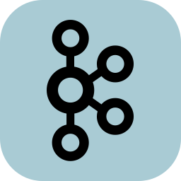
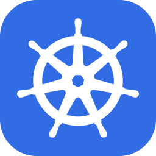

<h1 align="center">Hi, I'm Saeed Zeydabadi 👋</h1>

  

  <a href="https://www.linkedin.com/in/saeed-zeydabadi/">LinkedIn</a> · <a href="mailto:saeedzed2002@gmail.com">Email</a>

I’m a Computer Engineering student building Python APIs and event-driven commerce systems. I focus on clear service boundaries, reliable background work, and reproducible delivery.

## Featured project

### [FastAPI Microservices Platform](https://github.com/saeedzed2002/fastapi-microservices-platform)

A portfolio commerce backend with event-driven workflows for checkout, fulfillment, and post-delivery returns across independently deployable services.

- Services own their PostgreSQL data. An outbox relay publishes events to Kafka, and idempotent consumers handle duplicate delivery.
- GitHub Actions installs the Helm charts in a disposable Kind cluster and runs end-to-end checks for checkout, shipping, and returns.

[Reviewer guide](https://github.com/saeedzed2002/fastapi-microservices-platform/blob/main/docs/portfolio/reviewer-guide.md) · [CI runs](https://github.com/saeedzed2002/fastapi-microservices-platform/actions/workflows/platform-ci.yml)

## Selected work

- **[Nivaro Gaming](https://github.com/saeedzed2002/Nivaro)** · Bilingual hardware storefront backed by six FastAPI services, with simulated checkout and a local backup and restore workflow.
- **[Nosh](https://github.com/saeedzed2002/nosh-ordering-platform)** · Local restaurant-ordering demo with server-enforced checkout rules, customer order tracking, and a role-protected operations workspace.
- **[VOLUMA](https://github.com/saeedzed2002/voluma-architecture)** · Bilingual publishing platform with protected editorial tools, asynchronous media processing, and a repeatable Compose smoke test.
- **[Auremont](https://github.com/saeedzed2002/auremont)** · Django and PostgreSQL demo for a watch storefront.

## Tech stack

<!-- Icon credits: assets/skills/SOURCES.md -->

### Core stack

  
  
  
  

`Python` · `Django` · `FastAPI` · `Docker`

### APIs & persistence

  
  
  
  

`Django REST Framework` · `Pydantic` · `SQLAlchemy` · `JSON Web Tokens` · `Alembic`

### Databases, caching & storage

  
  
  

`PostgreSQL` · `Redis` · `MinIO`

### Messaging & background jobs

  
  
  

`Apache Kafka` · `RabbitMQ` · `Celery`

### Containers & infrastructure

  
  
  
  

`Docker Compose` · `Kubernetes` · `Helm` · `NGINX`

### CI & code quality

  
  
  

`GitHub Actions` · `pytest` · `Ruff`

## Current focus

Practising idempotency and recovery in event-driven workflows, and making Kubernetes delivery and integration tests repeatable.
